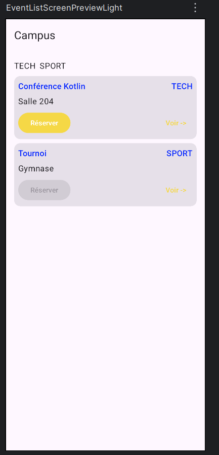
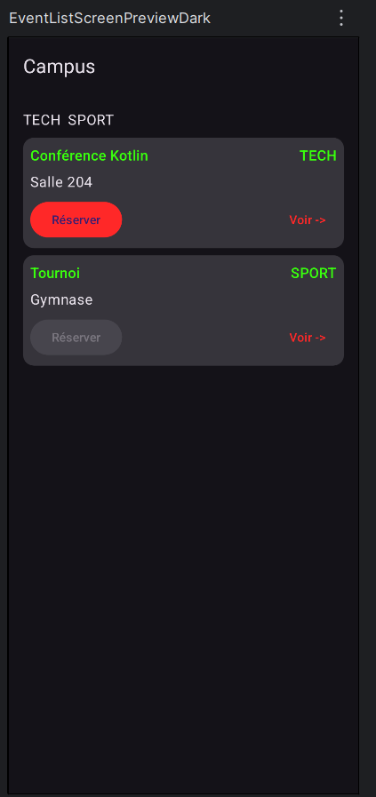
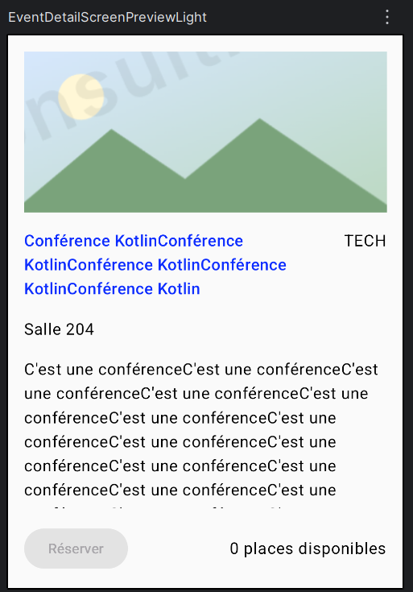
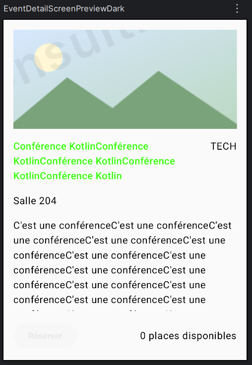

# Campus — Exercice 2

Application Android développée en Kotlin avec Jetpack Compose.

## Captures d'écran

### Liste des événements

**Mode clair**

**Mode sombre**

### Détail d'un événement

**Mode clair**

**Mode sombre**

